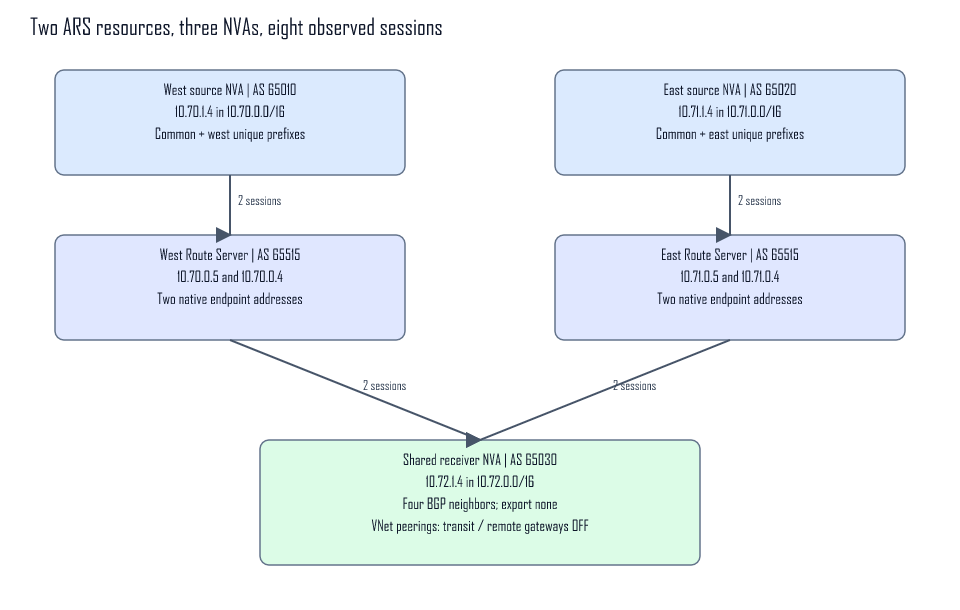
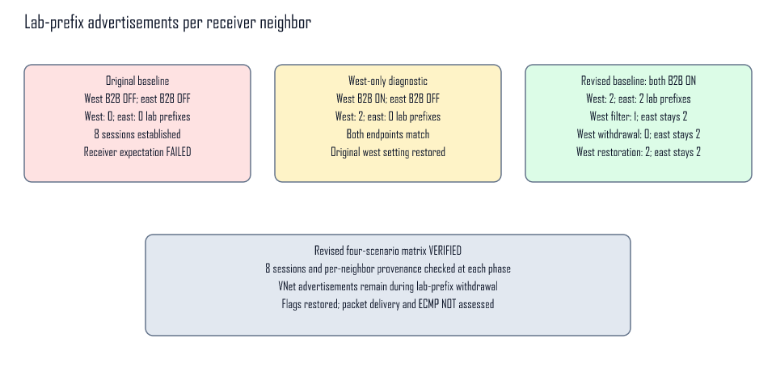

# Azure Route Server: endpoint-scoped NVA BGP qualification

An isolated Azure-only lab supporting [erjosito/vwan-visual-topology#259](https://github.com/erjosito/vwan-visual-topology/issues/259). Captured on 2026-11-23 in Sweden Central using two Standard Route Servers and three Ubuntu 22.04 / BIRD 2.0.8 VMs.

## Executive summary

**Eight actual endpoint-specific BGP sessions were established, not merely four configured peer records.** In the original configuration, both Route Servers learned their source NVA's two prefixes and programmed them into local NIC effective routes, but the shared receiver received only VNet prefixes.

A controlled change to **west Route Server only**, enabling `allowBranchToBranchTraffic`, caused both west endpoints to advertise the missing NVA prefixes. Unchanged east remained a negative control. Gateway transit and use-remote-gateways stayed disabled in every peering direction. The west setting was restored after capture.

With both ARS flags explicitly enabled, the revised four-scenario suite passed: eight endpoint sessions, duplicate-prefix provenance, west source export filtering and west withdrawal/restoration with east as the independent positive control. Native learned/advertised routes, BIRD RIBs and NIC effective routes were cross-checked at every phase. **The original receiver-prefix expectation failed; it is not retroactively a passing baseline.** Final cleanup is recorded in `results.json` after absence verification.

## Topology



| Resource | Address / ASN | Configuration |
| --- | --- | --- |
| West hub VNet | `10.70.0.0/16` | RouteServerSubnet `10.70.0.0/26`; NVA subnet `10.70.1.0/24` |
| East hub VNet | `10.71.0.0/16` | RouteServerSubnet `10.71.0.0/26`; NVA subnet `10.71.1.0/24` |
| Shared VNet | `10.72.0.0/16` | NVA subnet `10.72.1.0/24` |
| West Route Server | `10.70.0.5`, `10.70.0.4` / 65515 | Two native endpoints, in observed API order |
| East Route Server | `10.71.0.5`, `10.71.0.4` / 65515 | Two native endpoints, in observed API order |
| West source NVA | `10.70.1.4` / 65010 | Exports `10.200.0.0/24` and `10.201.0.0/24` |
| East source NVA | `10.71.1.4` / 65020 | Exports `10.200.0.0/24` and `10.202.0.0/24` |
| Shared receiver NVA | `10.72.1.4` / 65030 | Imports from both endpoints of both ARS; exports nothing |

West/shared and east/shared have bidirectional VNet peerings: VNet access and forwarded traffic enabled; gateway transit and use-remote-gateways disabled. There is no direct west/east peering, inter-ARS BGP transit, VPN gateway, ExpressRoute circuit or native route map.

Approved scope: 3 VNets, 5 subnets, 2 Standard Route Servers, 3 `Standard_B2ts_v2` VMs, 3 NICs, 3 NSGs, 3 30-GB StandardSSD OS disks and 5 Standard public IPs. Public SSH/RDP was denied; management used Run Command. Subscription-policy-created Defender extensions on the task VMs were also present. Cleanup discovered three additional subnet NSGs with the exact task ownership tags; deletion was initially blocked until their exclusive attachments to the three task NVA subnets were verified. Full account-effective cost was not verified; this is not a pricing estimate.

## Observed adjacency matrix

| Local NVA endpoint | Remote ARS endpoint | Local / remote ASN |
| --- | --- | --- |
| West source `10.70.1.4` | West `10.70.0.5` | 65010 / 65515 |
| West source `10.70.1.4` | West `10.70.0.4` | 65010 / 65515 |
| East source `10.71.1.4` | East `10.71.0.5` | 65020 / 65515 |
| East source `10.71.1.4` | East `10.71.0.4` | 65020 / 65515 |
| Shared receiver `10.72.1.4` | West `10.70.0.5` | 65030 / 65515 |
| Shared receiver `10.72.1.4` | West `10.70.0.4` | 65030 / 65515 |
| Shared receiver `10.72.1.4` | East `10.71.0.5` | 65030 / 65515 |
| Shared receiver `10.72.1.4` | East `10.71.0.4` | 65030 / 65515 |

BIRD observations validate actual state, neighbor address/ASN and local source address/ASN. Native learned/advertised frames retain `RouteServiceRole_IN_0` / `_IN_1` and each row's actual `localAddress`. The observed role-to-address mapping is evidence for this capture, not a universal or permanent physical-instance mapping.

## Scenarios



| Scenario | Expected lab prefixes per receiver endpoint | Result |
| --- | --- | --- |
| Original baseline, both B2B flags off | West: common + west unique; east: common + east unique | **Failed**: neither side advertised lab prefixes; all eight sessions established |
| Diagnostic, west B2B on / east off | West: common + west unique; east: no lab prefixes | **Observed** at both endpoints on each side; west setting restored |
| Revised baseline, both B2B flags on | West: common + west unique; east: common + east unique | See verified `results.json` |
| Revised west source export filter | West: common only; east unchanged | See verified `results.json` |
| Revised west source export withdrawal | West: no lab prefixes; east unchanged | See verified `results.json` |
| Revised west source export restoration | Original revised matrix restored | See verified `results.json` |

The filter is implemented in **BIRD source export**, not a native ARS route map. "Zero" means zero west lab prefixes, not an empty entire BGP table: VNet advertisements remain. Assertions keep eight established sessions separate from prefix counts and retain duplicate-prefix provenance independently for all four receiver neighbors. Both ARS flags and the west BIRD configuration are restored after the revised run.

## Reproduction and collection

Provision the address plan above in a new, explicitly approved resource group and subscription. Check VM SKU catalog and live deployment capacity independently. Ubuntu 22.04, BIRD 2.0.8 and Standard Route Server were used here. Discover actual Route Server endpoint addresses; never assume `.4` is the first endpoint.

```powershell
# Supply your own approved subscription and resource names.
$sub = '<your-subscription>'
$rg = '<your-isolated-lab-group>'
$ars = '<your-route-server>'
$sourcePeer = '<your-source-peer-registration>'
$readerPeer = '<your-reader-peer-registration>'
$nva = '<your-nva-vm>'
$nic = '<your-nva-nic>'

az network routeserver show --subscription $sub -g $rg -n $ars -o json
az network routeserver peering create --subscription $sub -g $rg `
  --routeserver $ars -n $sourcePeer --peer-ip 10.70.1.4 --peer-asn 65010
az network routeserver peering create --subscription $sub -g $rg `
  --routeserver $ars -n $readerPeer --peer-ip 10.72.1.4 --peer-asn 65030

# Record the original value before this controlled setting change.
az network routeserver update --subscription $sub -g $rg -n $ars --allow-b2b-traffic true
az network routeserver peering list-learned-routes --subscription $sub -g $rg `
  --routeserver $ars -n $sourcePeer -o json
az network routeserver peering list-advertised-routes --subscription $sub -g $rg `
  --routeserver $ars -n $readerPeer -o json
az network nic show-effective-route-table --subscription $sub -g $rg -n $nic -o json
az vm run-command invoke --subscription $sub -g $rg -n $nva `
  --command-id RunShellScript --scripts 'birdc show protocols all; birdc show route all' -o json
```

Example west source BIRD configuration (repeat the BGP stanza for the second **observed** west endpoint):

```text
router id 10.70.1.4;
protocol device {}
protocol static lab {
  ipv4;
  route 10.200.0.0/24 blackhole;
  route 10.201.0.0/24 blackhole;
}
protocol bgp west_0 {
  local 10.70.1.4 as 65010;
  neighbor 10.70.0.5 as 65515;
  multihop;
  ipv4 { import all; export where proto = "lab"; };
}
```

The receiver uses local `10.72.1.4` / ASN 65030, four native-derived neighbors, `import all; export none;`, and no static source routes. West filtering changes export to `filter { if proto = "lab" && net = 10.200.0.0/24 then accept; reject; }`; withdrawal uses `export none`; restoration reinstates the exact baseline.

Collectors require explicit `BGP state` and complete capture delimiters. The correct per-protocol query is `birdc show protocols all west_0`: `birdc show protocols west_0 all` returns a syntax error even with exit code zero. Azure Run Command may combine stdout/stderr under `ProvisioningState/succeeded` and truncate large results; neither malformed nor truncated output is evidence of a down session or zero routes.

## Findings and application implications

1. **B2B is material to NVA-to-NVA advertisements in this peered-VNet arrangement.** Source learning and local SDN programming succeeded with B2B disabled; remote receiver advertisements did not. A west-only flag change established the controlled contrast without changing peering association or source export.
2. **ARS learned routes are not NVA received routes.** Native learned west paths contain `65010` and next hop `10.70.1.4`; native advertised and receiver paths contain `65515 65010` with next hop equal to the advertising ARS endpoint. Preserve source provenance separately; do not copy source RIB attributes into a claimed receiver wire view.
3. **Configured membership, actual establishment and received prefix counts are separate facts.** Four ARS peer registrations produced eight observed sessions. All eight remained established in the original negative baseline despite zero received lab prefixes.
4. At the pre-fix application qualification baseline (`c7bcaa0469ebee970cbef0286f6511fdd5b4642d`), the [two-ARS shared-reader fixture](https://github.com/erjosito/vwan-visual-topology/blob/c7bcaa0469ebee970cbef0286f6511fdd5b4642d/tests/fixtures/nva-bgp.ts) uses B2B disabled while its [NVA projection test](https://github.com/erjosito/vwan-visual-topology/blob/c7bcaa0469ebee970cbef0286f6511fdd5b4642d/src/azure-net/nva-bgp.test.ts) expects source-prefix reflection and source RIB attributes at the receiver. This live evidence is tracked by [erjosito/vwan-visual-topology#447](https://github.com/erjosito/vwan-visual-topology/issues/447), not a claim that those predictions are Azure-qualified.

## Limits

This is control-plane and NIC effective-route evidence, **not** a packet-delivery, ECMP, failover-time or convergence-time certification. No BIRD kernel export was configured. This does not qualify same-VNet NVA reflection, native ARS route maps, ER circuit/MSEE physical identity, independent ER path withdrawal, or VPN gateway instance behavior. No customer topology, cloud account identifier, credential or raw bootstrap output is published. Reviewed evidence uses synthetic lab addresses and allowlisted route/session fields.

An ARS endpoint appearing as a wire BGP next hop does not establish that ARS forwards data packets. Native API `origin` values are retained as API fields, not certified IOS BGP ORIGIN attributes. Diagrams show labeled control-plane relationships, not packet-forwarding paths.

Portal screenshots were not captured; CLI/BIRD outputs are the authoritative observations. The application epic remains open for unqualified work.

## Cleanup

**Cleanup is verified:** the exact creation-proven task resource group is absent, and the explicit subscription contains zero resources with this run's correlation tag. The final inventory contained 28 resources, including the three verified task-tagged subnet NSGs and Defender extensions on task VMs; their group and children were deleted.

Only the creation-proven task group and its resources were in scope. Pre-existing, shared and customer resources were excluded. Historical preflight deletion is not counted as cleanup of this deployed run. `results.json` records final absence verification.

## References

- [Azure Route Server overview](https://learn.microsoft.com/en-us/azure/route-server/overview)
- [Route Server FAQ](https://learn.microsoft.com/en-us/azure/route-server/route-server-faq)
- [Configure Route Server, including branch-to-branch](https://learn.microsoft.com/en-us/azure/route-server/configure-route-server)
- [Route Server IP configuration ARM schema, 2024-05-01](https://learn.microsoft.com/en-us/azure/templates/microsoft.network/2024-05-01/virtualhubs/ipconfigurations)
